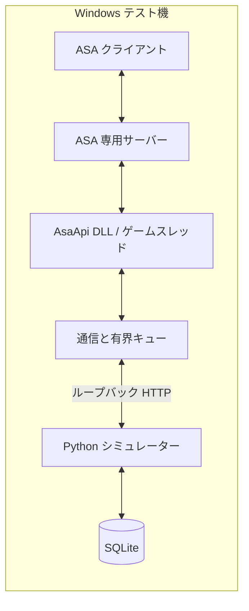

# システム構成

## 責務

| 部分 | 担当 |
|---|---|
| C++ ゲームアダプター | ゲーム状態、実体の生成・操作、地形を観測。Ready 後のゲームスレッドで許可リスト・座標・所有・リビジョンを再確認し、有界キューから時間と件数を制限して実行 |
| 通信境界 | 値のコピー、バージョン交渉、接続状態、キュー圧力、結果とイベントの配送。ゲームスレッドでの I/O 待機やワーカーへの UE ポインター移転を避ける |
| Python シミュレーター | 文明・都市・人口・勢力・経済・生産・道と配置・物流・タスク・外交・軍事・詳細度。永続化は単一の SQLite ライターにまとめる |
| ゲームの保存 | 物理実体、ゲーム所有の在庫・耐久・状態。論理モデルとの照合は再起動後に実施 |
| 仮想アダプター | 同じ通信契約で小規模地形・在庫・結果を再生し、実機未成立部分から独立して計画を検証 |

プレイヤーが区画に来た場合は最新スナップショットで制約を確認し、在庫と個体の変更権限を一度に一方へ移す。不確かな区画は外部計画の状態で保留。接続切断後は指示済みの通常ゲーム挙動を維持し、未着手の変更は期限とセッションで失効する。

## 外部シミュレーターの言語

| 候補 | 開発速度・ライブラリ | 性能・運用 |
|---|---|---|
| Python | 高い。標準 SQLite、プロファイラ、将来の NumPy / SciPy / OR-Tools 等 | 純 Python の大量ループ、スレッドによる CPU 並列が制約。計測点だけ配列化や別プロセス化 |
| C++ | ネイティブライブラリとプラグインの経験を共用可能。ビルド配布とメモリ管理の負担 | 低レベル制御に強い。ゲーム SDK を外部側へ持ち込むと移植性と独立テストが低下 |
| Rust | 型・所有権で境界を表現しやすい。ゲーム DLL と異なるツールチェーンで、最適化・科学計算の統合に追加検証 | ネイティブ性能と安全な並行性。単一の計算カーネルや独立サービス化に適する |

既設 Python 3.12 を起点に再生可能な小シナリオを作る。最初の SQLite は単一ファイル・単一書き手。データ量が増えれば読み取りモデルの更新周期を調整し、ベンチマークでボトルネックが特定された計算だけを分離する。

ゲームと通信の境界は [通信](communication_protocol.md)、保存権限と障害復旧は [データモデル](data_model.md)、近遠の扱いは [性能](performance.md)。
