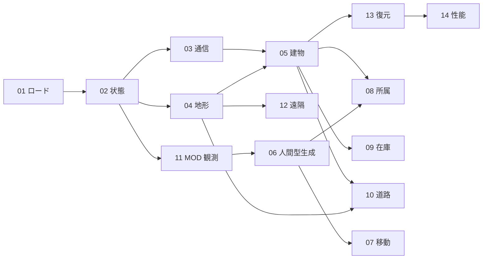

# 技術検証計画

以下は Phase 1 以降の計画。すべて独立した小規模試験として、共通ベースラインから必要な依存だけを使う。対象は既存セーブと分離した使い捨て Windows 専用サーバーと小区画。開始前に ASA buildid/表示版、AsaApi タグ・SHA、ローダー、MSVC、マップ、MOD ファイル番号、設定を記録。各実験は前後の観測・ログ・再現手順を保存する。

## 順序と分岐

01–03 を優先。04→05→13 は DevKit なしの最小集落の成立を判断する経路。MOD の自然スポーン観測は 11a として 02 後に先行し、外部制御確認 11b は 06/07/08 の結果を使う。12 は無人区画へ現物変更を拡張する前に必須。14 のバニラ・観測負荷は 02 から採取できる。NPC が成立しない場合は建築のみの増分性能を先に測定する。

| PoC | 前提 | 手順 | 成功条件 | 失敗条件 | 候補 API / 代替 |
|---|---|---|---|---|---|
| 01 ビルド・ロード | 隔離サーバー、版を固定、VS と同版 SDK | バニラ起動。ローダー追加。空の DLL を Release x64 でビルド・配置。起動・停止を繰り返し、PDB を添付。任意で解除・再ロード | Init/Unload の対応が記録され、停止後に処理が残らない | ビルド不通、欠落オフセット、停止・クラッシュ | Plugin_Init/Unload、PluginInfo、plugins.load/unload / 既設 v143 が不成立なら v145 承認、既知互換セットを照合 |
| 02 サーバー観測 | 01 | 起動前後で Ready と World を計測。マップ、ゲーム時刻、接続数を空・接続の条件で比較 | 値とログ一致。Ready 前は状態取得を保留 | 誤マップ、クライアント切断後に接続数不一致、参照不正 | S1/S2 / バニラログの読み取り |
| 03 双方向通信 | 02、Python 3.12。仮想側は単独試験可 | ループバックで echo 相当の読み取り指示・観測。重複、欠番、過大本文、版不一致、切断・再接続を注入 | 同 ID は一度だけ処理、欠番再同期、飽和/切断中に変更拒否、tick 待機なし | 二重適用、無限キュー、古い boot_id が通る | S2/S9 / 専用 HTTP ワーカー、仮想アダプター |
| 04 地表・衝突 | 02、座標を記録した試験区画 | 平地、坂、壁、岩木、水辺、対象外で垂直・補助トレース | 既知の地面と法線を許容誤差内で識別。誤差は測定前にマップの測定方法ごとに指定 | 屋根を地表と判定、観測不可を自由空間に扱う | S3/S12 / 人手確認済み格子 |
| 05 建物 | 03/04、標準部材、使い捨て区画 | クラス解決。許可セルで一件作成、生成前後の占有/耐久/複製を比較。禁止セル拒否、管理対象を削除 | 表示・衝突・耐久・所有の観測が合う。専用セルのみ変化 | 初期化失敗、禁止位置に生成、隣接へ誤変更 | S3/S4/S5。配置の成立は 13 で保存確認 / プレイヤーが通常配置し計画を照合、仮想配置 |
| 06 人間型 NPC | 02/11a、作者資料または管理対象として確認できたクラス | 自然個体と同型の試験個体を一体生成。初期化、AI、位置、削除・再出現を観測 | 正しいサーバー/クライアント外見、AI 初期状態、削除でき、自然個体には影響なし | 姿だけ、AI なし、MOD 台帳の漏れ・予期しない再出現 | S3/S4/S7 / 自然 NPC 観測、論理人口 |
| 07 移動目標 | 06、制御契約の候補 | 到達地点/障害付/到達不能を各一件。成功、失敗、停止を観測 | 目標近傍に規定時間内で到達、到達不能報告と停止、指示の上書きなし | テレポートのみ、無限追従、AI 競合 | S7 と作者確認済み制御 / 論理移動、既存 AI |
| 08 勢力 | 05、NPC 部分は 06 後 | 二つのテスト勢力で部材・個体の所属、利用許可、敵味方判定を確認。再起動後に照合 | 所有表示・利用権限・ゲームの敵味方・DB が一致 | Team 番号だけ変わり権限/表示が不一致 | S5/S8 / 外部勢力と個別対応 |
| 09 在庫 | 05、NPC 部分は 06 後。許可された倉庫と試験資源 | 読取、積増し、削減、容量超過、二重・途中失敗。設備の電力 ON/OFF 比較 | 現物と台帳数量・クライアント表示一致。失敗時の数量を追跡可能 | 無記録の損失・重複・他所有への影響 | S5/S6 / 外部台帳・手動移送 |
| 10 道路 | 04/05 | 平地三部材、折れ、坂、短橋の順。支持、通行、破壊時の閉鎖を確認 | 通行でき、支持と接合が再起動後も一致 | 浮遊、橋の支持不整合、連続配置が拒否される | S3/S5 / 外部道路グラフと手動ランドマーク |
| 11 既存 MOD | 02、正規導入承認、MOD 一つずつ | a バニラ観測との差分、自然スポーンとクラス確認。b 06/07/08 の公開契約で生成・移動・停止・所有・保存を試す | a 版付きで観測可。b 競合せず外部制御と保存を再現できる | 外部インターフェース不明、MOD AI が上書き、安定 ID なしの場合は b 未成立 | S4/S7/S8/S10・作者契約 / MOD は観測のみ、論理個体 |
| 12 遠隔/休眠 | 04、可能なら 05 の管理対象 | 近傍→退域→無人→再訪。衝突、可視、アクター一覧、個体 tick、再観測を分ける。無人配置は独立テストでのみ候補を調べる | 未観測・休眠・削除が区別でき、遠隔論理進行と再訪が整合 | 幽霊実体や二重生成、存在不明の状態で変更を受理 | S1/S3/S10 / 遠隔変更は保留 |
| 13 保存復元 | 05、03。NPC 版は 06/11b 後 | 正常保存と再起動、実行後 ACK 前に停止、ゲーム側のみテスト用旧世代に復元、区画内で手動破壊 | 独立した再観測で現物は一つ以下、台帳に重複なし。競合時に変更を凍結 | ポインターをキーにする、未観測で再生成、資源二重計上 | S5/S8、SQLite ジャーナル / 手動照合と新規操作の停止 |
| 14 負荷 | 基準は 02。建物 05、NPC 06、復元試験 13 | [性能計画](performance.md) に従い実体、部材、観測頻度を別々に上げる | 再現可能な基準と上限が決まり、上限で安定して制限が働く | 計測中クラッシュ、持続的なページング、データ不整合 | S2/S9 と OS カウンター / 物理実体数縮小、詳細度を下げる |

倉庫・地形・NPC の実機試験で依存 API が欠ける場合は、不明箇所と対象ビルドを記録し、その途中状態から既存セーブへ移行しない。
